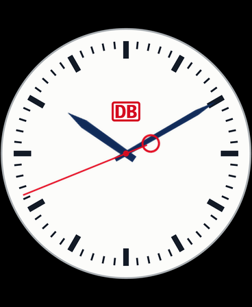

# ESP32 Station Clock

A DB-style railway clock for the **Waveshare ESP32-S3-Touch-AMOLED-1.8 V2**: a 58-second sweep, a two-second pause at twelve, and a short minute-hand advance. The original DB logo is retained; this is an independent project with no DB affiliation. See [third-party notices](THIRD_PARTY_NOTICES.md).



## Install without ESP-IDF

Open the **[browser installer](https://stationclock.net/)** in desktop Chrome or Edge. No ESP-IDF installation is needed:

1. Connect the V2 board with a USB data cable.
2. Confirm the board model and choose **Install firmware**.
3. Close the installer dialog, then choose **Connect clock** in the setup section.
4. Set Wi-Fi, timezone and brightness. The page sets time from your computer when connected; Wi-Fi enables automatic SNTP updates.

The browser uses Web Serial. Flashing is provided by a locally bundled ESP Web Tools distribution. Configuration uses the firmware's existing USB text protocol; Improv is not required. Wi-Fi credentials travel directly from the page to the board, are cleared from the form, and are not sent to a server or saved in browser storage. They are stored in the board's NVS settings.

A factory install replaces the firmware and clears saved settings. V2 hardware is verified; the original revision and other Waveshare display sizes are not. ESP32-S3 chip detection alone cannot identify the display board.

The installer is hosted on GitHub Pages from this [source repository](https://github.com/danohn/esp32-station-clock). For a local copy, use the preview described below or the command-line flashing instructions in [firmware/README.md](firmware/README.md).

## Build from source

Requires **ESP-IDF v5.5.2** and a C++ toolchain supplied by it. Generated artwork is included, so artwork regeneration is optional.

With an activated ESP-IDF environment:

```sh
idf.py set-target esp32s3
idf.py build
idf.py -p YOUR_SERIAL_PORT flash
```

For an optional project-local SDK installation on macOS/Linux, install Git and [uv](https://docs.astral.sh/uv/), then:

```sh
tools/setup_idf.sh
tools/idf.sh build
tools/idf.sh -p YOUR_SERIAL_PORT flash
```

SDKs, toolchains, and local history live in ignored `.local/`. The wrapper also supports an externally installed SDK through `IDF_PATH`. ESP-IDF uses its separate supported Python 3.12 environment; our Python tools use Python 3.14 managed by `uv`.

## USB controls

```sh
uv sync
uv run tools/clockctl.py sync
uv run tools/clockctl.py status
uv run tools/clockctl.py wifi
uv run tools/clockctl.py timezone Berlin
uv run tools/clockctl.py timezone Sydney
uv run tools/clockctl.py brightness 65
uv run tools/clockctl.py demo
uv run tools/clockctl.py live
uv run tools/clockctl.py forget-wifi
```

Use `--port PORT` before the subcommand if automatic detection is ambiguous. The Wi-Fi command prompts for a hidden password. Close the browser's serial connection before using the command-line tool, and vice versa. Opening native USB serial can restart the board on macOS; the tool drains boot output before timestamping a sync command.

Double-tap the display to replay 10:09:54 through the minute change. It returns to live time after 12 seconds.

## Build and preview the static website

Requires Node.js 22+ and the Python tooling dependencies. First build the firmware, then:

```sh
uv sync
uv run tools/package_firmware.py
npm ci
npm run build:site
npm run preview
```

Open **http://localhost:4173** in desktop Chrome or Edge. Web Serial requires HTTPS on a deployed site; localhost is allowed for development. Do not open the HTML directly as a file.

- `site/` contains tracked HTML, CSS, JavaScript and the serial protocol client.
- `.local/site/` is the generated static website, including the merged image, checksum, installer manifest, artwork and ESP Web Tools bundle.
- All site assets use relative URLs so a GitHub Pages project subpath works.
- The page's **Project** link is filled from `GITHUB_REPOSITORY` during the Pages build; local previews use an in-page project section.
- Firmware binaries and staged website output are ignored in Git. Both are produced from the same checked-out source by CI.

## GitHub Actions and Pages

The included workflow compiles the ESP32-S3 firmware, checks generated artwork, runs native movement tests and simulated browser tests, and uploads firmware/site artifacts. It does not publish automatically on pushes.

Firmware outputs are cached by ESP-IDF version and a hash of the firmware source, artwork, dependency lock and build configuration. Website, documentation and test changes reuse an exact cache match and skip both the SDK container and firmware compilation. Firmware input changes, SDK updates or an expired cache trigger a fresh build. The installer is still packaged and tested on every run.

To publish an updated installer from this repository:

1. Push `main` to GitHub.
2. Keep **GitHub Actions** selected as the source in repository **Settings → Pages**.
3. Open **Actions → Build, test and prepare installer → Run workflow**.
4. Enable **Deploy the checked build to GitHub Pages**.

The deployment is gated on successful firmware and site tests. Local browser tests use Chrome; CI installs Playwright Chromium. Physical USB flashing is a separate manual check and is not simulated as a claim of hardware verification.

## Artwork and tests

SVGs in `assets/` are the editable artwork masters. The generator reads them, rasterises at 4× size, downsamples for edge coverage and writes the embedded RGB565/BGRA C arrays plus the preview:

```sh
uv run tools/generate_assets.py
uv run tools/generate_assets.py --check
mkdir -p .local
c++ -std=c++17 -O2 tests/test_movement.cpp -o .local/test-movement
.local/test-movement
npm test
npm run test:browser
```

Browser tests need a prepared `.local/site/`. On Linux, install the Playwright browser with `npx playwright install --with-deps chromium` and use `CI=1 npm run test:browser`. Screenshots and browser reports stay ignored.

## Project map

| Path | Purpose |
| --- | --- |
| `main/clock_main.cpp` | Application, timekeeping, SNTP, RTC, USB commands and LVGL hand layers |
| `main/movement.hpp` | Hardware-independent hand-angle and pause calculations |
| `main/board_display.cpp` | V2 display reset, QSPI port, DMA buffers and touch startup |
| `assets/` | SVG artwork masters and generated PNGs |
| `main/generated/` | Generated image data compiled into the firmware |
| `site/` | Browser installer and USB setup interface |
| `tools/` | Portable build, artwork, packaging, preview and USB utilities |
| `tests/` | Native movement, serial-protocol and browser interface checks |
| `docs/` | Hardware verification and movement/timekeeping explanations |
| `firmware/` | Flashing instructions and ignored generated image/checksum |
| `.local/` | Ignored SDKs, toolchains, local history, logs and staged site |

## Timekeeping and limits

Network time comes from `pool.ntp.org` over SNTP. The ESP32 keeps time between updates; the PCF85063 RTC restores UTC after a reset while it remains powered. Sydney and Berlin include daylight-saving rules; UTC is also available.

The 180 ms minute-hand advance is an adjustable approximation, and the reconstructed face is not a manufacturer-supplied drawing. Rendering varies with hand angle and does not sustain 60 fps. V2 hardware, live motion, USB configuration, RTC restoration, and Wi-Fi reconnection/SNTP were checked on 21 October 2026. See [hardware verification](docs/hardware.md) and [movement details](docs/movement.md).

Original code is MIT-licensed. DB branding and third-party dependencies retain their own terms; see [THIRD_PARTY_NOTICES.md](THIRD_PARTY_NOTICES.md).
